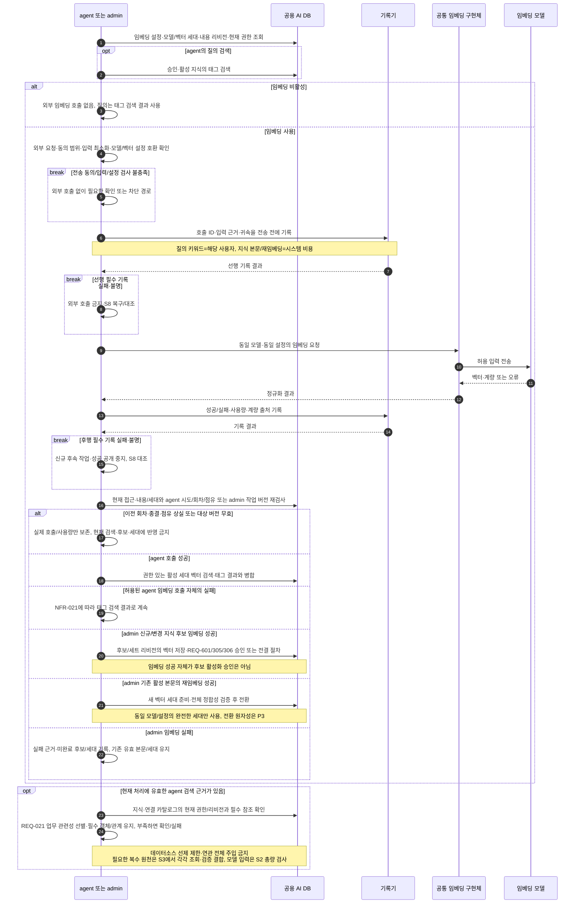

# 모델·업무 도구·임베딩 호출 시퀀스

아래 ‘읽는 순서’의 번호는 여러 메시지를 업무 단계로 묶은 설명 번호이며, 그림의 화살표 자동 번호와는 다릅니다. 조건에 맞는 분기만 실행하고, 병행 경로는 동시에 진행됩니다.

[전체 연결](agent-request-sequences.md)의 호출 상세다. 각 그림은 현재 실행 자격을 가진 agent의 처리다.
전송 전 권한·점유 검사와 호출 사이의 경합을 없다고 가정하지 않는다. 실제 외부 호출을 AI DB 트랜잭션으로 롤백할 수 없다.
기록기 처리의 저장·실패·중복 계량 방지는 [DES-005](agent-history-sequences.md), 실행 자격 상실·중단은 [DES-003](agent-lifecycle-sequences.md)을 따른다.

전송 정책의 정본: 업무 자료의 모델 입력은 REQ-106의 사용자 요청·동의 범위를 호출 전에 검사한다. 직접 입력은 안내된 제출, 기존 결과는 결과 버전·대상·목적에 대한 동의를 기록한다. 분류·임베딩·재주입에도 같은 범위를 적용한다. 2026-10-27 대조에서 지식/모델 불필요 경로와 동의·필수 기록 실패의 차단을 전체 흐름 및 S2~S4에 반영했다. 물리 계약·실환경 시험과 상세 설계 승인은 후속이다.

## S2 반복 모델 호출과 쿼터 검사

**S2 검토 위치** — [REQ-010 요구사항](../generated/10-요구사항정의서/04-요구사항/02-질의-해석과-실행.md#req-010-요구사항) · [전체 흐름도](../generated/10-요구사항정의서/04-요구사항/02-질의-해석과-실행.md#req-010-전체-흐름도) · [단계별 대응표](../generated/10-요구사항정의서/04-요구사항/02-질의-해석과-실행.md#req-010-단계별-대응표) · [이 그림의 순서 설명](#s2-읽는-순서)

**관련 처리 경로** — [S3 파라미터·승인·SQL·업무 API](agent-call-sequences.md#s3-파라미터-승인-sql-업무-api) · [S4 질의 임베딩·지식 재임베딩](agent-call-sequences.md#s4-질의-임베딩-지식-재임베딩) · [S5 사용자대기·다른 인스턴스 이어가기](agent-lifecycle-sequences.md#s5-사용자대기-다른-인스턴스-이어가기) · [S6 다른 인스턴스의 변경·중단 입력](agent-lifecycle-sequences.md#s6-다른-인스턴스의-변경-중단-입력) · [S8 감사·사용량·최종 응답 종결](agent-history-sequences.md#s8-감사-사용량-최종-응답-종결)

**검토 순서** — [← S1 이전 검토](agent-request-sequences.md#s1-접수-시작-비동기-폴링) · [S3 다음 검토 →](agent-call-sequences.md#s3-파라미터-승인-sql-업무-api)

근거: REQ-001·002·003·004·007·009·015·034·038·106·108·610, ARCH-040, NFR-010·012·013·026·027.

```mermaid
sequenceDiagram
    autonumber
    participant G as agent 그래프 실행
    participant D as 공용 AI DB
    participant H as 기록기
    participant C as 독립 제어 경로
    participant M as 공통 모델 구현체
    participant L as CLI 또는 공급자 API
    G->>D: 현재 자격·채택 계획·작업 상태·유효한 과거 조건/결과 참조·버전 조회
    Note over G,D: REQ-001/002의 대상·범위·기한·권한 확인, 조건 재조회와 보존 결과 가공 구분
    break 필수 미완료 작업이 남았으나 실행 가능한 작업·진행 호출·유효 대기 없이 정체
        G->>G: REQ-004 no_progress의 추가 확인 또는 실패 종결
        Note over G,D: 동일 계획/호출을 반복하거나 새 회차로 예산을 초기화하지 않음
    end
    opt 모델 없이 진행 가능한 확정 작업
        G->>G: S3 또는 결정적 서버 처리·필요한 현재 통제 적용
        G->>D: 실제 결과를 해당 작업에 연결·상태 갱신 후 다음 작업 선택
    end
    loop 중복 진행 호출 없이 후속 모델 응답 또는 허용된 다음 보조 후보가 필요
        G->>D: 점유·현재 시도/회차·중단 이벤트·누적 스텝/재작성·정체 제한 확인
        G->>D: 현재 계획/작업 상태 버전 재조회·부족 조건 확인
        G->>G: 단계 역할·허용 작업 결정, 주 추론은 시도에 고정된 모델/effort 사용
        opt 보조 판정 역할
            alt 별도 논리 보조 작업 시작
                G->>H: 후보 설정/입력 버전·순서 확보, 1순위부터 시작
            else 같은 보조 작업의 다음 후보 또는 유효한 이어가기
                G->>H: 저장된 순번·원 호출 종료 근거·고정 마감 대조
            end
            G->>G: REQ-602의 허용 오류·남은 후보·현재 조건 검사
            opt 후보 경로에 대한 추가 동의 필요
                G->>G: 미전송 상태로 S5 확인, 원 마감/순번 유지
            end
            break 전환 불가·후보/예산 소진·거부·마감 만료 또는 아직 동의 대기
                G->>H: 역할별 확인/실패·미전송 사유, 업무 재실행 없음
            end
        end
        G->>D: 처음 필요한 내용 리비전 선택·현재 접근 권한 검사
        G->>G: 규칙·템플릿·필요한 계획/작업 상태·유효 근거·응답 형식 조립
        G->>G: 전체 입력·생성 예약/여유의 문맥 한도·동의 범위·마스킹·오염 경계 검사
        G->>D: 다음 호출에 적용할 쿼터 재검사 설정값 조회
        alt 재검사 활성
            G->>D: 현재 개인 한도와 커밋된 사용량 비교
            G->>H: 판정 시각·한도·사용량·설정·허용/차단 기록
        else 재검사 비활성
            G->>H: 검사 생략 사유·적용 설정 기록
        end
        H-->>G: 기록 결과
        alt 쿼터 차단 또는 호출 전 검사/필수 기록 실패
            G->>G: 호출하지 않고 해당 실패·기록 복구 경로로 종료
            Note over G,D: 쿼터 차단은 모델 없이 안내, 이미 수행한 업무와 사용량 유지
        else 호출 허용
            opt 첫 보조 후보의 전송 허용
                G->>H: 해석된 모델 호출 상한으로 전체 후보 사슬 마감 고정
            end
            Note over G,M: 후보마다 남은 시간·현재 권한/동의·해당 스텝/분류 예산 적용
            G->>H: 호출 ID·원/후속 후보 관계·시도/스텝·모델/effort·계약/규칙 버전·입력 근거 기록
            H-->>G: 전송 전 기록 결과
            break 전송 전 필수 기록 실패·불명
                G->>G: 모델 전송 금지·S8 대조 경로
            end
            Note over G,M: 보조 호출은 아래 후보 사슬을 적용하며 매 후보가 현재 검사·필수 기록을 통과
            G->>M: 공통 요청·현재 응답 계약
            M->>L: 공급 경로별 역할·메시지·도구 형식 변환 후 전송
            par 호출과 독립된 제어
                loop 유한 호출 대기 중
                    C->>D: 점유 갱신·중단/변경 이벤트·현재 회차 확인
                    alt 점유 상실
                        C->>C: 로컬 결과 적용·새 호출 중지, 공용 실행 상태 쓰기 금지
                        C->>M: 해당 모델 호출의 취소/유한 정리 요청
                        Note over C,H: 원 호출 감사·계량만 허용, 새 소유자 상태 변경 금지
                    else 유효 점유에서 명시 중단
                        C->>D: 점유/회차 조건부로 무효 결과 적용·후속 실행 차단
                        C->>M: 현재 호출의 지원 취소 수단 요청
                        Note over C,M: 청크 없음/비스트리밍도 제어, 미지원/실패는 유한 종료 대기
                    else 유효 점유에서 변경 확정
                        C->>D: 영향받는 결과 차단·변경 사전 허용/전송 근거 기록
                        C->>M: S6의 검증된 변경 경로 적용
                        Note over C,M: 같은 실행 변경 / 공급자 자동 후속 / Hub 종료 후 재요청 구분
                    end
                end
            and 구현체별 응답 수신
                alt 운영 API 스트리밍 또는 지원 CLI
                    loop 수신 청크
                        L-->>M: 청크·사용량 정보 또는 오류
                        M-->>G: 정규화된 응답 실행 경계·콘텐츠·계량 이벤트
                        G->>H: 같은 실행에 연결 또는 확인된 자동 후속 스텝을 한 번 생성
                        Note over G,H: 접수/청크/블록은 새 스텝 아님, 선행 시작 기록과 중복 생성 금지
                    end
                else 개발 CLI 비스트리밍
                    L-->>M: 전체 응답·종료·오류 또는 타임아웃
                end
                Note over G,M: 미완성/무효 응답은 실행·최신 표시 금지, 공급자 생성 종료는 별도 확인
            and 개별 응답 실행 완료 처리
                loop 각 실행의 완료·거절·오류가 확인될 때
                    M-->>G: 실행별 완결 응답·거절/오류·계량 원본
                    Note over G,L: 연결 종료를 기다리지 않고 수신 경로와 독립적으로 처리
                    G->>H: 각 응답 실행의 결과·사용량을 DES-005로 기록
                    H-->>G: 기록 결과
                    break 후행 필수 기록 실패 또는 불명
                        G->>G: 결과 채택·후속 후보 전송 금지, S8 대조
                    end
                    G->>D: 현재 시도·회차·점유·중단과 요청 당시 계획/작업 상태 버전 재검증
                    alt 보조 판정의 확인된 일시 장애 종료·현재 유효 작업·다음 후보 존재
                        G->>H: 오류/전환 근거·다음 순번 저장, 원 마감/예산 유지
                        Note over G,M: 다음 반복에서 모든 검사, 동일 후보 재전송 없음
                    else 정상 응답이며 결과가 현재 처리에 유효
                        G->>G: 타입·필수값·단계 허용 작업 검증 후 분기
                        G->>H: 구조화 응답 검증 판정·거부/보완 근거 기록
                        H-->>G: 기록 완료
                        G->>D: 검증된 계획/작업 제안·실제 모델 실행 결과·유효 참조·그래프 상태 저장
                        Note over G,D: 모델의 완료 주장은 실제 업무 완료가 아님, S3의 실제 작업 결과로 판정
                        G->>G: 실행 가능한 다음 작업 선택, 도구/확정 가공은 S3·사용자 확인은 S5
                        Note over G,D: 모델이 더 필요 없으면 루프 종료, 진행 근거 없으면 정체 확인/실패
                        opt 자동 후속 대기를 해소할 유효 결과·승인 결과가 준비됨
                            G->>M: 현재 조건·권한·승인·새 실행 허용 검사 후 필수 결과 제출
                            M->>L: 공급자 계약에 따른 대기 해소 입력
                            Note over G,L: 같은 변경을 중복 시작하는 요청과 구분, 미승인/무효 도구 실행 금지
                        end
                        Note over G,D: 검증 통과만 작업 후보로 사용, 계약 오류는 한도 내 보완 또는 실패 경로
                    else 금지 오류·후보 소진·늦은 응답 또는 무효 회차
                        G->>G: 오류는 역할별 실패/확인, 늦은 응답은 현재 업무 반영 금지
                        Note over G,H: 실패·사용량 보존, 주 추론 수동 새 시도·입력 분류 최종 실패는 S6
                    end
                end
            end
            Note over G,L: 활성 응답/제어 처리가 끝나면 이 구간 종료, 재사용 연결의 닫힘을 기다리지 않음
        end
    end
```

### S2 읽는 순서

1. 모델을 호출하기 전에 agent는 현재 시도·회차·점유가 유효한지, 중단 요청이 있는지, 같은 시도에 누적한 스텝·재작성·정체 제한을 넘지 않았는지 확인합니다. DB의 채택 계획과 작업별 실행 상태를 먼저 읽고, 모델 없이 가능한 확정 작업은 S3/서버 처리로 진행합니다. 필수 미완료 작업이 남았는데 실행 가능한 작업·진행 호출·유효 대기가 없는 정체는 REQ-004.no_progress의 확인 또는 실패로 처리합니다.
2. 이번 단계의 목적과 역할에 맞는 허용 작업을 결정합니다. 주 추론 모델·effort는 ARCH-040의 시도 고정값을 쓰고 보조 역할은 해당 역할 설정을 따릅니다. 필요한 내용 리비전과 현재 접근 권한을 확인하고, 규칙·기술 템플릿·동적 입력에 이번 응답의 형식 안내까지 합쳐 프롬프트를 만듭니다.
3. REQ-001·002의 서버 기록에서 필요한 과거 대상·최종 조건·결과 버전/범위를 찾고, 원천 새 조회와 보존 사본 가공을 구분합니다. 후보가 모호하면 확인하고 만료 자료를 재주입하거나 자동 재조회하지 않습니다. REQ-003에 따라 전체 조립 입력과 생성 예약·오차 여유를 포함한 문맥 한도, 외부 요청·동의 범위, 마스킹과 오염 경계를 검사합니다. 이어서 이번 호출의 쿼터 재검사 설정에 따라 현재 한도·사용량을 비교하거나 생략 사유를 기록합니다. 요약·사본 가공으로 원자료 기한과 공개 범위를 넓히지 않습니다.
4. 쿼터나 호출 전 검사에서 막히거나 필수 기록에 실패하면 모델을 호출하지 않습니다. 허용되면 호출 식별자, 모델·설정, 계약·규칙 버전과 입력 근거를 기록한 뒤 공통 구현체가 공급사 형식으로 변환해 전송합니다.
5. 독립 제어 경로가 호출 대기 중 점유를 갱신하고 중단·변경을 확인합니다. 청크가 없어도 제어해야 합니다. 변경은 S6와 REQ-007.model_change_contract에 따라 같은 실행 변경·공급자 자동 후속·Hub 종료 후 재요청을 구분합니다. 자동 후속은 사전 통제가 가능한 경로만 사용하고 중복 새 요청을 보내지 않습니다. 수신 이벤트는 실제 응답 실행 경계로 정규화하며 최초 전송의 선행 기록에 연결하거나 자동 후속 시작이 확인된 때 새 스텝을 만듭니다. 접수·콘텐츠 블록·청크마다 스텝을 추가하지 않습니다.
6. 개별 응답 실행의 완료·거절·오류가 확인되면 연결 종료와 무관하게 수신 경로와 독립적으로 결과·실제 사용량을 기록하고 후속 검증으로 전달합니다. 취소로 계량을 받지 못하면 NFR-010에 따라 추정 가능분과 미상을 구분합니다. 계량 수신 여부와 관계없이 결과를 지금 처리에 반영할 자격과 요청 당시 계획/작업 상태 버전이 여전히 유효한지 다시 확인합니다. 늦은 응답이나 무효 회차의 결과는 기록만 남기고 업무 상태에는 반영하지 않습니다. 점유를 잃은 경로는 공용 실행 상태를 쓰지 않고 해당 호출의 로컬 정리·감사·계량만 수행합니다.
7. 유효한 응답은 타입·필수값·허용 작업을 검증하고 판정 근거를 기록합니다. 검증된 계획/작업 제안을 채택하되 모델의 완료 주장을 실제 수행 결과로 저장하지 않습니다. 실제 결과는 해당 작업에 연결하고 그 상태에서 도구 실행·결정적 처리·사용자 확인·필요한 모델 호출 또는 실패를 선택합니다. 동일 실행 변경은 저장된 적용 사건과 현재 조건 버전도 대조합니다. 자동 후속이 진행/대기 중이면 같은 변경을 다시 요청하지 않습니다. 다만 대기 해소에 필요한 유효한 도구 결과·승인 결과는 기존 통제와 새 실행 허용 검사를 거쳐 공급자 계약대로 제출합니다. 이는 같은 변경의 중복 요청과 구분하며 대기 자체가 무효/미승인 도구 실행을 허용하지 않습니다. Hub의 별도 추가 요청이 필요하면 처음 검사부터 반복하고, 종료 조건이면 반복을 끝냅니다.

[↑ S2 다이어그램](#s2-반복-모델-호출과-쿼터-검사) · [전체 흐름도로 돌아가기](../generated/10-요구사항정의서/04-요구사항/02-질의-해석과-실행.md#req-010-전체-흐름도) · [← S1 이전 검토](agent-request-sequences.md#s1-접수-시작-비동기-폴링) · [S3 다음 검토 →](agent-call-sequences.md#s3-파라미터-승인-sql-업무-api)

현재 권한은 매 접근 시 판정하고 내용 리비전 고정으로 생략하지 않는다. 허용된 도구·인자도 서버가 다시 검증한다.
보조 판정 모델 호출도 질의를 발생시킨 사용자 사용량에 포함한다. 모델 거절·시간 초과·잘못된 응답은 정상 결과가 아니다.
공급 경로 오류의 자동 대체는 REQ-602.auxiliary_fallback의 보조 판정에만 적용한다. 주 추론·시스템 운영·임베딩은 해당 후보 사슬에 포함하지 않는다. 안전한 호출의 재시도·보완 상한과 중단 전이는 NFR-020·022 및 REQ-009에 연결한다.
루프의 차단·종료 분기는 루프 탈출을 뜻한다. 다음 반복에서 임의로 재개하지 않는다.
@defer P3 프롬프트 조합·구조화 출력·실행 분기가 같은 소스 계약을 참조하는 방식과 CLI 지원 차이를 계약 시험으로 확정한다.

### S2 보조 판정 후보 대체

위 반복의 보조 분기는 REQ-602.auxiliary_fallback을 따릅니다. 새 논리 보조 작업은 당시 설정의 1순위부터 시작하고, 같은 작업의 다음 후보는 저장한 순번·설정/입력 버전·마감을 유지합니다. 후보별 전송은 최대 한 번이며 정상 결과가 채택되면 해당 사슬은 끝납니다. 다음 논리 작업을 시작하는 경우와 구분합니다.

후보 공급 경로 집합은 자료 전송 안내/동의에 미리 포함합니다. 새 경로 추가는 기존 동의를 넓히지 않습니다. 추가 동의가 필요하면 미전송 상태로 S5에 인계하며 응답 후에도 원 작업의 남은 시간·현재 권한·동의를 검사합니다. 거부·만료는 후속 전송을 막습니다. 첫 전송 전 대기에는 기존 사용자대기 기한을 적용하고 첫 전송 후에는 사슬 마감도 유지합니다.

사전/후행 필수 기록 실패, 금지 오류, 후보 소진과 예산 차단은 역할별 확인·실패로 연결합니다. 부분 응답·접수/종료 불명은 자동 대체하지 않습니다. 재접속·소유자 인계가 같은 후보를 중복 전송하거나 순번을 초기화하지 않아야 합니다. 늦은 응답은 채택 결과를 덮지 않고 원 호출의 감사·계량으로만 처리합니다. 입력 의도 분류의 최종 실패는 S6로 인계하며 완료 업무는 재실행하지 않습니다. 검증 기준은 TC-2091~2097·TC-3041~3042입니다.

## S3 파라미터 승인 SQL 업무 API

**S3 검토 위치** — [REQ-010 요구사항](../generated/10-요구사항정의서/04-요구사항/02-질의-해석과-실행.md#req-010-요구사항) · [전체 흐름도](../generated/10-요구사항정의서/04-요구사항/02-질의-해석과-실행.md#req-010-전체-흐름도) · [단계별 대응표](../generated/10-요구사항정의서/04-요구사항/02-질의-해석과-실행.md#req-010-단계별-대응표) · [이 그림의 순서 설명](#s3-읽는-순서)

**관련 처리 경로** — [S2 반복 모델 호출과 쿼터 검사](agent-call-sequences.md#s2-반복-모델-호출과-쿼터-검사) · [S5 사용자대기·다른 인스턴스 이어가기](agent-lifecycle-sequences.md#s5-사용자대기-다른-인스턴스-이어가기) · [S7 점유 만료·늦은 응답·새 턴 요청](agent-lifecycle-sequences.md#s7-점유-만료-늦은-응답-새-턴-요청) · [S8 감사·사용량·최종 응답 종결](agent-history-sequences.md#s8-감사-사용량-최종-응답-종결)

**검토 순서** — [← S2 이전 검토](agent-call-sequences.md#s2-반복-모델-호출과-쿼터-검사) · [S4 다음 검토 →](agent-call-sequences.md#s4-질의-임베딩-지식-재임베딩)

이 S3 상세도는 RM-P1 일반 실행 및 워크플로우 수동 실행의 카드 승인 경로다. RM-P3 예약 실행의 관리자 활성화 승인·실행별 적합성 검사는 REQ-405를 따르며 별도 상세 설계에서 연결한다. 두 경로 모두 실제 값 확보·현재 권한/정책·원값 보호·결과 불명 통제를 거치고 자동 승인을 가짜 카드 응답으로 표현하지 않는다.

근거: REQ-005·007·009·021·022·023·026·037·038·039·103·105·111·113·114·301·303·608·612, NFR-022. 전송 여부와 실행 성공은 별개다.

```mermaid
sequenceDiagram
    autonumber
    participant G as agent 실행
    participant D as 공용 AI DB
    participant H as 기록기
    participant T as 등록 도구 실행기
    participant W as 업무 DB 또는 API
    G->>G: 채택 계획의 작업 또는 검증된 모델 제안이 현재 후보·등록 계약에 속하는지 검증
    alt 파라미터 미확보/미검증 또는 복수 후보
        G->>G: 허용된 입력값 조회·모델 재호출 또는 DES-003 사용자 확인
        Note over G,T: 실제 호출에 쓸 모든 값을 먼저 확보·검증, 확보 후 같은 S3 진입 검사부터 재개
        Note over G,T: 미정 값이 있으면 최종 승인 요청/실행 금지
    else 모든 파라미터 최종 값 확보·검증
        G->>D: 현재 사용자·대상별 신원·자산·행 스코프·점유 확인
        G->>G: REQ-022 업무 용어 계획 표시·REQ-023 현재 계획의 확인 필요 여부/유효 확인 검사
        break 필요한 계획 확인이 아직 없음
            G->>G: S5 계획 확인 대기 후 현재 조건으로 다시 진입
            Note over G,D: 계획 확인은 전체 실제 값에 대한 실행 승인과 별개
        end
        alt SQL 조회
            G->>T: 파싱·카탈로그·읽기 전용·행 스코프·기본 필터 적용 검증
            G->>T: 최종 SQL/바인딩의 필수 기간·최대 범위·대체 식별키·참조별 제약 검증
            Note over G,T: REQ-301 제약 우회/검증 불가는 차단, 원천별 SQL·실행 계약 적용
            break REQ-037이 허용한 실행 전 파싱·카탈로그 대조 실패
                G->>G: 현재 조건·재작성 누계 검사 후 정제 피드백으로 S2 보완 또는 실패
                Note over G,T: 권한·정책/필수 제약 거부는 재작성으로 우회 금지, 새 SQL도 전체 검사
            end
        else 업무 실행 액션 또는 명시 승인 대상 커스텀 도구
            G->>G: 서버 실행 식별·원 실행 연결과 제공자 멱등성 계약 확인, 기본 미보장
            opt 결과 불명 원 실행에 연결된 새 턴의 후속 실행
                G->>G: REQ-105에 따라 최신 실행의 대상 시스템 확인 내용·처리 범위·후속 의도 검사
                G->>H: 사용자 확인 출처·대상·시각·내용 기록, 원 불명 결과 유지
                Note over G,H: 미확인·처리 중·모호함은 실행 차단, 매 후속 실행마다 새 확인과 새 승인 필요
            end
            opt 최종 액션/순서/인자에 대한 유효 사용자 승인 없음
                G->>D: 원값 암호화 저장·최종 대상/순서/버전과 실제 연결/주체 해석 근거 고정
                D-->>G: 저장 성공·승인 대상과 원값 임시본 참조
                G->>G: 같은 버전의 전체 실제 값으로 DES-003 승인 카드 요청
                Note over G,D: 사용자가 전체 실제 값을 확인한 뒤 최종 승인, agent가 검증하며 승인 후 값 채움 금지
            end
            G->>D: 최종 승인된 액션·순서·전체 값·만료·현재 권한·실제 목적지/주체 대조
            G->>D: 승인 버전에 연결된 원값 임시본 조회
            D-->>G: 유효한 암호문 또는 부재/무효/오류
            G->>G: 복호화·승인값 동일성 검사, 실패 시 호출 차단
            Note over G,D: 미승인·변경·만료는 DES-003으로, 승인 전송 경로를 우회하지 않음
        else 등록 조회 API
            G->>T: 등록 입력·출력 계약·대상·권한 검증
        end
        alt 검증/필요한 사용자 확인/승인 불충족
            G->>H: 거부 또는 추가 확인 필요 근거 기록
        else 실행 가능
            G->>H: 호출 ID·인자/승인 참조·대상·타임아웃·실행 전 사실 기록
            H-->>G: 전송 전 기록 결과
            break 전송 전 필수 기록 실패·불명
                G->>G: 업무 전송 금지·S8 대조 경로
            end
            G->>D: 디스패치 경계의 점유·회차·중단·승인과 실제 연결/주체 재확인
            Note over G,D: 불충족이면 아래 전송 경로를 실행하지 않음
            opt 업무 실행 액션
                G->>D: 중단과 순서를 판정해 디스패치 직전 액션 전송 방어 기록 저장
                Note over G,D: action_executed는 성공 증명이 아님, 실패 시 호출 금지
            end
            G->>T: 검증한 실제 입력으로 호출·조회 취소 수단 등록
            T->>W: SQL 또는 등록된 업무 API 요청
            Note over G,W: 동기 조회 중 S6의 독립 제어 경로로 취소 가능, 전송한 실행은 취소 불가 안내
            W-->>T: 결과·취소 오류·기타 오류 또는 타임아웃/응답 불명
            T->>T: 해당 호출의 취소 수단 해제·늦은 취소/재사용 경합 방어
            T-->>G: 유형화된 결과와 실행/취소 근거
            G->>H: 외부 결과·불명·소요 시간·오류 유형을 별도 기록
            H-->>G: 결과 기록 결과
            break 결과 필수 기록 실패·불명
                G->>G: 신규 후속 작업·성공 공개 차단·S8 대조 경로
            end
            G->>D: 현재 실행 자격·회차·중단 반영 검사
            alt 중단 반영 또는 실행 자격 무효
                G->>G: S6의 취소/업무 결과 기록·필수 확인/정리, 후속 업무 처리 금지
            else 결과 유효·조회/실행 성공
                G->>G: 현재 권한·개인정보·마스킹·결정적 데이터 가공
                Note over G,D: 복수 원천은 REQ-021의 결합 키·단위·완전성·원천별 기준 시각 검사<br/>실패/잘림을 0건으로 대체하거나 전체 완료로 합산하지 않음
                G->>D: 실제 작업 결과·효과/부분 내역·유효 참조·계획 실행 상태 저장
                G->>G: 후속 모델에 필요하면 요청·동의 범위를 다시 검사
                G->>G: 적용 계약·공통 결과 가이드·업무별 매핑 설명/버전을 결과와 연결
                Note over G,T: S2 결과 안내/질문 제안 → 필요 시 DES-003 사용자대기 → 후속 작업은 S3의 현재 조건으로 재검증
            else DB/DW가 근거로 확인한 SQL_SYNTAX 실행 오류
                G->>G: REQ-037의 오류 유형·재작성 상한 검사
                G->>G: 정제된 오류로 모델 호출 경로 복귀
            else 상태 변경 실행의 응답 시간 초과/불명
                G->>G: 자동·무확인 재전송 금지·등록된 결과 확인 먼저 수행·불가/실패 시 수동 확인 안내
                G->>D: 통신 원인과 업무 결과 분리·자동 재시도 차단·남은 작업 미실행 저장
            else 안전한 조회 API/조회 도구의 최초 타임아웃
                G->>G: NFR-022 등록 안전성·현재 자격/중단·권한/필요 승인 재검사
                alt 재시도 허용·자동 횟수 미사용
                    G->>D: TIMEOUT_RETRYING 호출 시도 이력 선행 저장
                    break 선행 기록 실패·자격 상실
                        G->>G: 재시도 전송 금지·S8 대조 경로
                    end
                    G->>T: 같은 승인/입력 범위의 자동 재시도 1회·해당 호출 취소 수단 등록
                    T->>W: 등록된 안전한 조회 요청
                    W-->>T: 결과 또는 두 번째 타임아웃
                    T->>T: 해당 호출 취소 수단 해제·늦은 취소/재사용 경합 방어
                    T-->>G: 재시도 결과·취소/오류 근거
                    G->>H: 재시도 연결·결과·소요 시간 기록
                    G->>G: 같은 필수 기록·현재 권한/자격·결과 마스킹·작업 상태 저장 경로 적용
                    Note over G,D: 두 번째 타임아웃은 자동 종료, 수동 재시도 허용·불가역 실행 없으면 ABORTED/새 턴 안내<br/>DB/DW·전송된 상태 변경 실행은 제외, 모델 재호출/SQL 재작성으로 우회 금지
                else 등록 불허·중단·이미 자동 재시도 소진
                    G->>G: 추가 호출 없이 기존 오류/중단 규칙·사유 안내
                end
            else 부분 실패·결과 불명·무효 결과
                G->>G: 자동 재전송하지 않고 기존 부분 처리·확인·종결 규칙 적용
            end
            opt 업무 실행 원값의 사용 목적 종료
                Note over G,D: 기존 명세상 필요한 후속 처리·허용 자동 재시도까지 끝난 뒤 정리, 단순 조회 직후 삭제 금지
                G->>D: 해당 원값 임시본 사용 차단·삭제
                G->>H: 원값 없이 삭제 결과 기록, 실패 시 차단 유지·삭제 재처리/운영 경고
            end
        end
    end
```

### S3 읽는 순서

1. agent는 채택 계획의 작업 또는 모델 제안이 현재 단계에서 허용되고, 지식 후보와 등록된 도구 계약에 속하는지 확인합니다. 모델이 요청했다는 이유만으로 실행하지 않습니다. REQ-022의 업무 용어 계획을 표시하고 REQ-023의 확인이 필요한 경우 현재 계획에 대한 유효 응답을 받은 뒤 진행합니다. 계획 확인을 실행 승인과 합치지 않으며, 확인 생략 정책도 현재 권한·필수 입력·실행 승인을 생략하지 않습니다.
2. 입력값이 부족하거나 후보가 여러 개면 허용된 조회·모델 재호출·사용자 확인으로 값을 확보합니다. 사용자 입력·조회 결과·기본값·시스템 매핑 등 출처와 무관하게 실제 호출에 쓸 모든 파라미터의 최종 값을 확보하고 agent가 등록 입력 계약으로 검증합니다. 미정 값·자리표시자·승인 후 채울 값이 있으면 최종 승인을 요청하거나 실행하지 않습니다.
3. 모든 값이 준비되면 현재 권한·대상 신원·데이터 범위·점유를 검사합니다. SQL은 구문·카탈로그·읽기 전용·필터와 REQ-301.query_constraints의 최종 SQL/바인딩·참조별 제약을 확인하고, 조회 API는 등록 계약을 확인합니다. 조회 유형 커스텀 도구도 REQ-114의 명시 승인을 생략하지 않습니다. 승인 대상 액션/커스텀 도구는 REQ-105.approval_target_binding의 실제 연결·목적지·실행 주체 해석 근거와 최종 대상·순서·전체 파라미터 버전을 고정하고 원값을 공용 DB의 전용 임시 테이블에 암호화해 저장합니다. 저장 성공이 확인된 같은 버전의 실제 값을 승인 카드에 제시합니다. 사용자의 최종 승인 조작을 agent가 검증하며 LLM의 승인 해석은 근거가 아닙니다. 호출 시 같은 임시본을 읽어 복호화·승인값 대조를 통과해야 하며, 부재·오류를 새 조회나 클라이언트 값으로 보충하지 않습니다. 변경된 값은 새 버전으로 전체 확인·최종 승인받고 선행 결과 의존 액션도 값 확보 뒤 개별 승인합니다(REQ-005·026, ADR-025).
4. 검증이나 승인이 부족하면 사유를 기록하고 추가 확인 경로로 갑니다. 통과하면 호출 근거를 기록하고 전송 직전에 점유·회차·중단·승인과 실제 실행 대상의 동일성을 다시 확인합니다. 명시 연결/설정 교체로 목적지·주체의 의미가 달라지거나 동일성을 확인하지 못하면 전송하지 않고 재승인받습니다. 동일 주체·범위가 검증된 자격증명 교체만 정본의 예외를 적용하며 비밀 원문/해시는 승인 자료에 넣지 않습니다. 업무를 변경하는 액션일 때는 전송 방어 기록도 먼저 저장하며, 저장에 실패하면 호출하지 않습니다.
5. 등록 실행기가 검증된 입력으로 업무 DB나 API를 호출합니다. 조회 취소 수단은 해당 호출에 묶어 등록/해제하며, 동기 응답 대기 중에도 S6의 실행 서버 제어 경로가 취소를 요청할 수 있습니다. 이미 전송한 실행은 취소 불가를 안내하고 원 응답 또는 기존 타임아웃을 확인합니다. 반환된 결과·취소 근거·오류·타임아웃·응답 불명과 소요 시간을 별도 이력으로 남기고, 현재 실행 자격과 중단 반영을 다시 확인합니다.
6. 중단이 반영됐으면 새 업무 후속 처리를 시작하지 않고 S6의 호출별 결과 보고·필수 확인/정리로 연결합니다. 중단되지 않은 성공한 유효 결과는 현재 권한과 마스킹을 적용해 가공·저장합니다. 모델에 다시 보낼 필요가 있으면 외부 요청·동의 범위를 별도로 검사하고, 적용한 API/도구 공통 결과 가이드·지식 매핑별 설명·당시 버전을 결과와 연결합니다. 모델의 안내·질문과 구조화된 후속 작업 제안은 REQ-009.result_dialogue를 따릅니다.
7. 실행 전 파싱·카탈로그 대조 실패와 DB/DW가 확인한 SQL_SYNTAX 실행 오류를 REQ-037에 따라 구분하고, 허용된 후보만 현재 조건·같은 시도의 재작성 누계 검사 후 정제 피드백으로 S2에 보냅니다. 권한·정책 거부는 재작성으로 우회하지 않습니다. 안전한 조회 API/도구의 최초 타임아웃만 NFR-022의 선행 TIMEOUT_RETRYING 기록과 현재 조건 검사를 거쳐 자동 1회 재시도합니다. 재시도에도 같은 호출별 취소 수단 등록/해제·현재 조건·필수 기록·결과 마스킹·작업 상태 저장을 적용합니다. 두 번째 타임아웃은 종료하며 수동 재시도 허용·불가역 실행 없음 조건을 충족하면 ABORTED와 새 턴 요청을 안내합니다. DB/DW 타임아웃·전송된 상태 변경 실행을 이 경로에 넣거나 모델/SQL 재작성으로 제한을 우회하지 않습니다. 부분 실패·결과 불명·무효 결과는 이 분기의 자동 재전송 대상으로 삼지 않고, 기존 확인·부분 처리·종결 규칙을 따릅니다.
8. 실행 원값은 호출과 기존 명세상 필요한 후속 처리·허용 자동 재시도가 끝나면 삭제합니다. 중단·만료·회차/버전 무효화 시에도 사용을 차단하고 삭제하며, 거절 후 재승인은 최초 기한 안에서만 원값을 유지합니다. 삭제 실패·복구 후의 차단·재처리는 REQ-005를 따릅니다. 감사 이력·로그·일반 체크포인트에는 원값을 복제하지 않습니다.
9. 접수 성공이면 완료로 안내하지 않고, 가이드에 따라 선택적 결과 확인을 물을 수 있습니다. 응답이 필요한 경우 DES-003의 기존 사용자대기에서 유효한 선택만 이어갑니다. 결과 조회 선택은 원 실행 재전송이나 새 상태 변경 승인이 아니며, 후속 호출은 현재 후보·권한·계약·입력을 다시 검사하고 상태 변경이면 전체 값의 별도 승인을 받습니다. 장애의 필수 결과 확인은 NFR-022에 따라 질문 전에 우선합니다. 처리 중이면 권장 시간 뒤 사용자가 별도로 확인하도록 안내하고 자동 폴링하지 않습니다. 종결 뒤 요청은 새 턴으로 처리하며 과거 결과 불명을 소급 변경하지 않습니다. 결과 불명 실행의 사용자 확인 후 후속 실행은 REQ-105.manual_reexecution에 따라 최신 실행의 확인 내용과 새 승인을 받습니다. 후속 실행도 불명이면 그 시도에 대한 새 확인·새 승인으로 같은 절차를 거치며 자동 반복하지 않습니다. 새 턴/승인만으로 대상 시스템의 멱등성 키를 바꾸지 않고 REQ-105.idempotency_contract를 적용합니다.

[↑ S3 다이어그램](#s3-파라미터-승인-sql-업무-api) · [전체 흐름도로 돌아가기](../generated/10-요구사항정의서/04-요구사항/02-질의-해석과-실행.md#req-010-전체-흐름도) · [← S2 이전 검토](agent-call-sequences.md#s2-반복-모델-호출과-쿼터-검사) · [S4 다음 검토 →](agent-call-sequences.md#s4-질의-임베딩-지식-재임베딩)

SQL 자동 재작성은 REQ-037의 단계별 분류를 따른다. 실행 전 파싱·카탈로그 대조 실패는 허용 후보이며, DB/DW 실행 오류는 공급사 근거로 확인한 SQL_SYNTAX만 허용한다. DB/DW의 객체 부재·의미/타입 오류·연결·권한·타임아웃·알 수 없는 오류와 정책/필수 조건 거부를 재작성으로 통과시키지 않는다.
타임아웃은 업무 시스템의 미실행 증거가 아니다. 전송/시도한 상태 변경 실행은 자동·무확인 재전송하지 않고 결과 확인 또는 대상 시스템 수동 확인으로 연결한다. 원인인 응답 시간 초과와 업무 결과 확인 불가를 분리한다. 사용자 확인 후 새 승인으로 허용되는 후속 실행과 자동 재시도 차단을 구분해 안내한다(REQ-007·105, NFR-022).
복합 작업 최종 실패 시 독립 작업도 새로 시작하지 않는다. 수행·실패·미수행·불명을 표시하고 계속 여부와 재승인을 기존 규칙으로 처리한다(REQ-038).
최종 전달·도구 결과 재주입은 [DES-005](agent-history-sequences.md)의 감사 완료와 현재 권한·전송 통제를 거친다.

## S4 질의 임베딩 지식 재임베딩

**S4 검토 위치** — [REQ-010 요구사항](../generated/10-요구사항정의서/04-요구사항/02-질의-해석과-실행.md#req-010-요구사항) · [전체 흐름도](../generated/10-요구사항정의서/04-요구사항/02-질의-해석과-실행.md#req-010-전체-흐름도) · [단계별 대응표](../generated/10-요구사항정의서/04-요구사항/02-질의-해석과-실행.md#req-010-단계별-대응표) · [이 그림의 순서 설명](#s4-읽는-순서)

**관련 처리 경로** — [S1 접수·시작·비동기 폴링](agent-request-sequences.md#s1-접수-시작-비동기-폴링) · [S2 반복 모델 호출과 쿼터 검사](agent-call-sequences.md#s2-반복-모델-호출과-쿼터-검사) · [S8 감사·사용량·최종 응답 종결](agent-history-sequences.md#s8-감사-사용량-최종-응답-종결)

**검토 순서** — [← S3 이전 검토](agent-call-sequences.md#s3-파라미터-승인-sql-업무-api) · [S5 다음 검토 →](agent-lifecycle-sequences.md#s5-사용자대기-다른-인스턴스-이어가기)

근거: ARCH-060, IF-004, NFR-015·021, REQ-021·303·305·306·601. 지식 검색을 수행할 때 태그 검색은 항상 수행하며 벡터 검색 단독 구성은 없다. 지식이 불필요한 요청에는 이 S4를 강제하지 않는다.

### S4 읽는 순서

1. 호출 주체가 임베딩 설정, 모델과 벡터의 세대, 내용 리비전, 현재 권한을 확인합니다. agent의 질의 검색이라면 승인·활성 지식에 대한 태그 검색을 먼저 수행합니다.
2. 임베딩을 사용하지 않는 설정이면 외부 임베딩을 호출하지 않습니다. 질의 검색은 태그 검색 결과로 진행합니다.
3. 임베딩을 사용하면 외부 전송이 허용된 최소 입력인지와 모델·벡터 설정이 맞는지 확인합니다. 전송 검사 불충족이나 선행 기록 실패면 호출하지 않습니다. 허용된 호출 전에 입력 근거와 비용 귀속을 기록합니다. 질의 키워드 임베딩은 해당 사용자 사용량이고, 지식 본문·재임베딩은 시스템 비용입니다.
4. 공통 임베딩 구현체가 모델을 호출하고 벡터·계량 또는 오류를 받습니다. 성공 여부와 관계없이 호출 결과·사용량·계량 출처를 기록합니다. 후행 필수 기록 실패는 후속 검색/활성화로 넘어가지 않고 S8의 복구·대조로 보냅니다.
5. 현재 권한·내용/벡터 세대와 agent의 시도·회차·점유/중단 여부를 다시 확인합니다. 늦은 결과는 호출 사실·사용량만 보존하고 현재 처리에 적용하지 않습니다. 유효한 agent의 질의 임베딩이 성공하면 권한 있는 활성 지식의 벡터 검색 결과와 태그 검색 결과를 합칩니다. 임베딩 호출 실패라면 기존 규칙에 따라 태그 검색 결과로 계속합니다. 필수 기록 실패는 정상적인 검색 폴백으로 감추지 않고 기록 실패 경로를 따릅니다.
6. 유효한 agent 검색 결과는 REQ-021에 따라 지식과 연결 카탈로그를 업무 관련성으로 선별합니다. 데이터소스를 먼저 골라 후보를 제한하거나 연관됐다는 이유로 모두 주입하지 않습니다. 현재 권한과 필수 공개 객체·관계·예제 참조를 유지하고, 불완전한 예제·버전 충돌·필수 근거 부족은 확인/실패로 돌립니다. 복수 원천은 각 소속을 유지해 S3에서 따로 조회·검증하여 결합합니다. 실제 모델 입력은 S2의 총량·동의 검사를 다시 거칩니다.
7. admin 신규/변경 후보의 성공 벡터는 후보/세트에 연결해 REQ-601·305·306의 적용 승인 또는 전결 절차로 넘깁니다. 기존 활성 본문 재임베딩은 새 세대 전체를 준비·검증한 뒤 전환하며, 실패 시 기존 유효 지식/세대를 유지합니다. 현재 작업 대상/버전이 무효면 새 후보나 세대에 반영하지 않습니다. 성공만으로 승인·전환 검증을 대신하지 않습니다.

[↑ S4 다이어그램](#s4-질의-임베딩-지식-재임베딩) · [전체 흐름도로 돌아가기](../generated/10-요구사항정의서/04-요구사항/02-질의-해석과-실행.md#req-010-전체-흐름도) · [← S3 이전 검토](agent-call-sequences.md#s3-파라미터-승인-sql-업무-api) · [S5 다음 검토 →](agent-lifecycle-sequences.md#s5-사용자대기-다른-인스턴스-이어가기)

@defer P2/P3 질의 임베딩 호출 직전 개인 쿼터 재검사의 적용 범위·비용 한도 차단과 태그 검색 계속 조건을 NFR-012·021에 맞춰 확정한다. 사용자 사용량 집계 의무와 호출 허용 판단은 구별한다.
@defer P3 모델/설정 변경 후 전체 재임베딩·벡터 세대 전환·실패 재처리의 경합을 반영 세트 원자적 활성화와 대조한다. 다른 세대 벡터끼리 비교하지 않는다.

후속 계약 시험에는 모델 제안의 과거 계획/상태 버전, 결정적 작업의 불필요 모델 호출, 조회 커스텀 도구의 승인 누락, SQL 필수 제약 우회, 안전한 조회 자동 재시도 2회 초과, 동의/감사 실패 뒤 임베딩 전송, 늦은 벡터 반영과 재임베딩 실패 시 기존 세대 유실을 각각 반례로 포함한다.

선택한 카탈로그의 데이터소스마다 REQ-603.data_query_guides의 제목/상세 가이드를 중복 제거해 제공합니다. 업무 SQL 전에 필요한 코드·참조값은 현재 허용된 카탈로그/컬럼의 읽기 조회로 확인합니다. 가이드가 권한·행 필터·신원·마스킹·SQL 통제를 대신하지 않으며, 미확정 값은 추정 실행하지 않습니다. 사용한 가이드 리비전과 실제 조회/결과/시각은 해당 턴 근거에 남깁니다.
